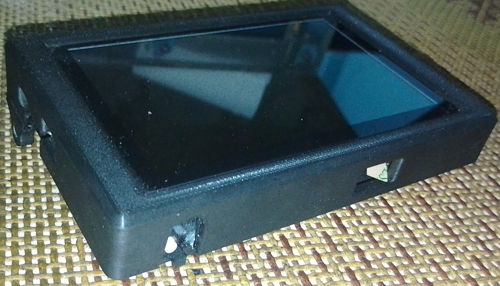
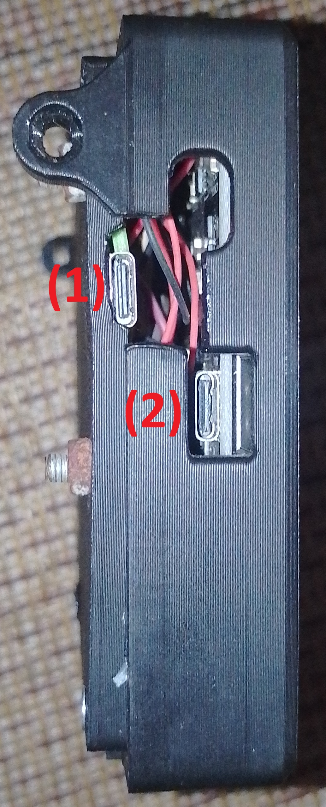
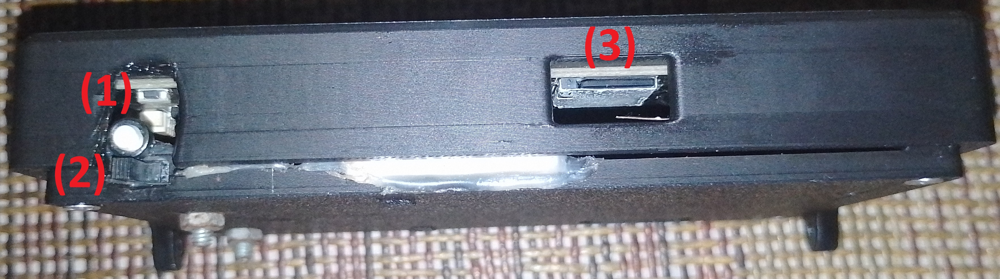
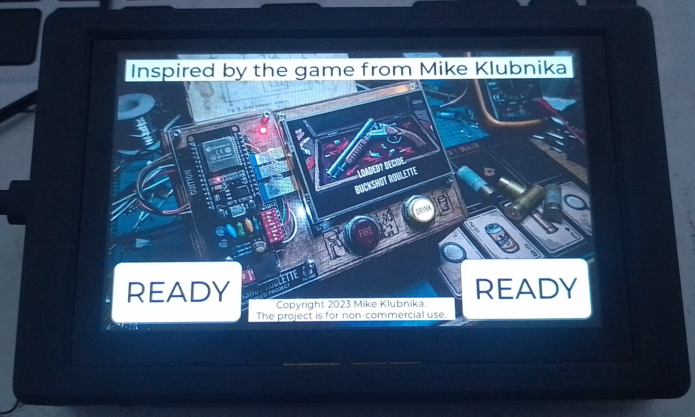
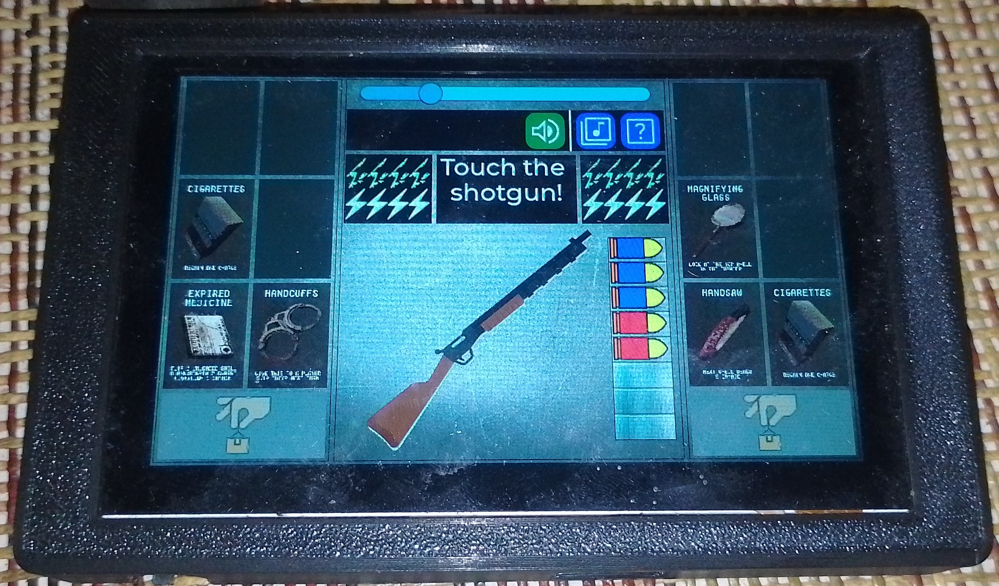
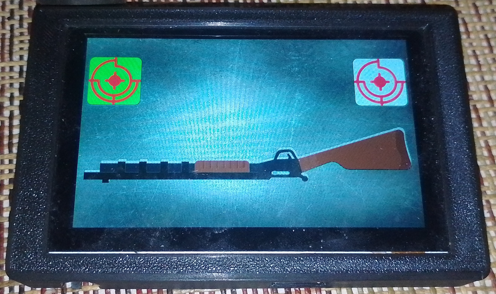
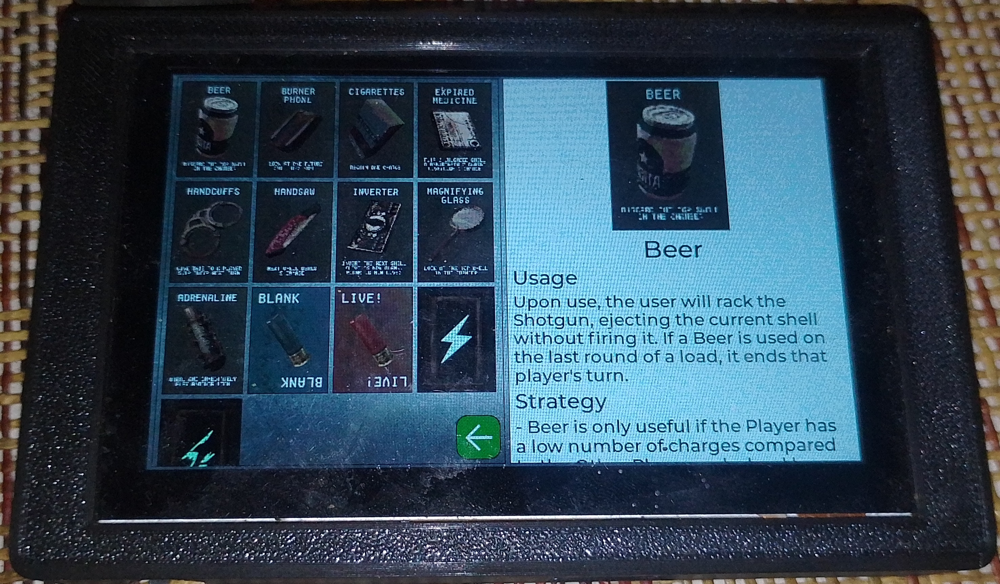
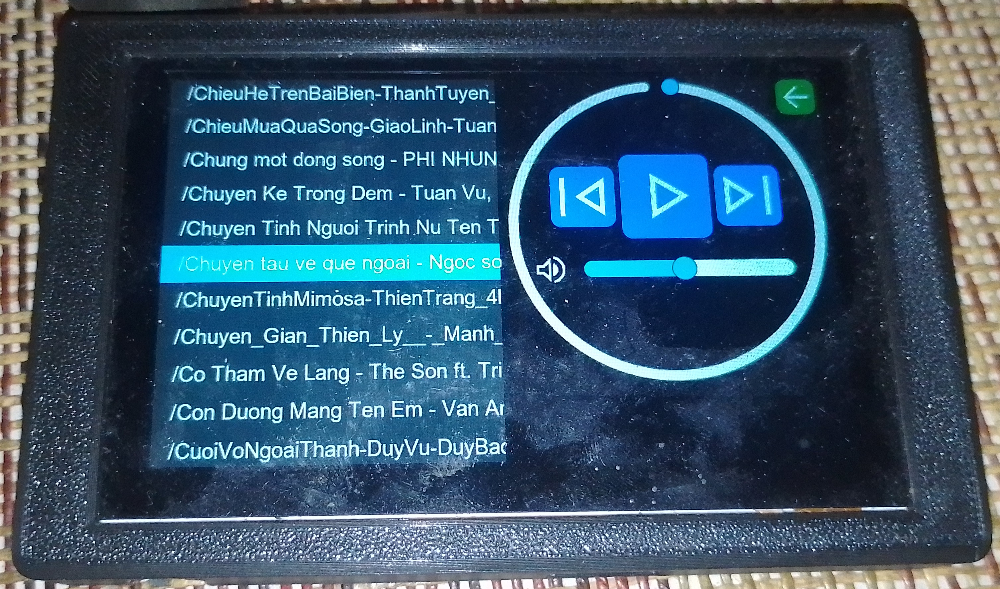

# 1. Tổng quan thiết bị

**Mặt trước:** Màn hình cảm ứng điện dung 5 inch

**Mặt trái:** các cổng kết nối type-C
1. Cổng sạc pin li-po
2. Cổng nạp code

**Mặt dưới:**
1. Nút nhấn kiểm tra dung lượng pin
2. Switch công tắc nguồn thiết bị
3. Khe cắm thẻ nhớ micro-SD

# 2. Phần mềm & Giao diện trên thiết bị

Giao diện người dùng được xây dựng trên nền tảng thư viện đồ họa **LVGL (v9.1)** và thiết kế qua **SquareLine Studio**, hoạt động theo máy trạng thái hữu hạn (**FSM**) kết hợp hệ thống hướng sự kiện trực quan. 

Kiến trúc phần mềm bao gồm **4 màn hình chính (Screens)** độc lập và **các cửa sổ/hộp thoại tương tác (Modal Windows/Popups)** hiển thị linh hoạt trong quá trình chơi:

## 2.1. Màn hình khởi động (Start Screen - `ui_Start`)

Màn hình xuất hiện đầu tiên khi khởi động thiết bị, phục vụ hai mục đích chính:
- **Xác nhận bắt đầu trận đấu (PvP Ready):** Cung cấp 2 nút bấm **"READY"** độc lập cho Player 1 và Player 2. Trò chơi chỉ chuyển sang màn hình chính khi cả hai người chơi cùng kích hoạt trạng thái sẵn sàng.
- **Thông tin dự án & Bản quyền:** Thể hiện thông điệp tri ân nhà phát triển Mike Klubnika và tuyên bố bản quyền phi thương mại của dự án.

## 2.2. Màn hình chính chơi game (Main Gameplay Screen - `ui_Main`)

Là trung tâm điều khiển toàn bộ trận đấu sinh tử giữa 2 người chơi:
- **Thanh công cụ điều hướng & Cài đặt:**
  - Nút chuyển nhanh sang **Màn hình nghe nhạc** (Music Player).
  - Nút chuyển sang **Màn hình trợ giúp** (Help/Card Info).
  - Nút bật/tắt toàn bộ âm thanh hiệu ứng (Sound Toggle).
  - Thanh trượt điều chỉnh độ sáng đèn nền màn hình (Brightness Slider) từ mức 0 đến 100%.
- **Khu vực quản lý người chơi (Player Table):**
  - **Hệ thống thanh máu 2 tầng (Defibrillator Charges):** Mỗi bên sở hữu tối đa 4 vạch máu thường (Level 1) và 4 vạch máu sinh tử (Level 2).
  - **Khay trang bị (Item Slots):** Mỗi người chơi có 6 ô chứa vật phẩm. Người chơi nhấn nút rút bài (Pick) để ngẫu nhiên nhận tối đa 3 vật phẩm/vòng (tối đa 6 vật phẩm dự trữ).
  - **Chỉ báo trạng thái:** Hiển thị lượt chơi hiện tại của từng người chơi và biểu tượng còng tay (Skip Icon) khi đối thủ bị khống chế bỏ lượt.
- **Khu vực bàn nạp đạn & Shotgun:**
  - **Hộp đạn thông minh:** Trước mỗi vòng nạp, nắp hộp đạn mở ra để công khai tổng số lượng đạn thật (Live - màu đỏ) và đạn giả (Blank - màu xanh) được nạp vào súng (từ 2 đến 8 viên ngẫu nhiên). Sau đó, hộp đạn đậy nắp và thuật toán tiến hành xáo trộn thứ tự đạn ngẫu nhiên vào buồng súng.
  - **Khẩu Shotgun trên bàn:** Nhấn vào khẩu súng để kích hoạt lượt bắn.

## 2.3. Cửa sổ tương tác Shotgun & Hiệu ứng chiến đấu (Shotgun Window & Effects)

Tích hợp dưới dạng các cửa sổ nổi (Modal Windows/Popups) và hiệu ứng thị giác ngay trên màn hình chính:
- **Hộp thoại xác nhận bắn Shotgun (`ui_wndShotgunConfirm`):** Khi chạm vào khẩu shotgun trên bàn, hộp thoại mở ra cho phép người chơi chọn mục tiêu: tự chĩa súng bắn bản thân (để giữ lượt nếu là đạn giả) hoặc chĩa súng bắn đối thủ. Nòng súng sẽ tự động xoay hướng theo góc của người được chọn (180° hoặc 0°).
- **Cửa sổ soi buồng đạn & Điện thoại nặc danh (`ui_imgbtnShotgunInside`):** Xuất hiện khi kích hoạt **Kính lúp** (nhìn thấy trực tiếp loại đạn đang nằm trong buồng súng) hoặc **Điện thoại** (nhận thông báo vị trí tương đối và loại đạn bí mật).
- **Cửa sổ trộm vật phẩm Adrenaline (`ui_wndAdrenalineEffect`):** Mở giao diện cho phép người chơi chọn và cướp ngay một vật phẩm từ khay đồ của đối phương để sử dụng tức thì.
- **Hiệu ứng cưa nòng & Tia lửa đạn:** Hình ảnh khẩu shotgun chuyển sang nòng cưa ngắn (`ShotgunCut`) với sát thương x2 khi dùng cưa tay, đi kèm hiệu ứng tia lửa đạn và khói súng khi nổ đạn thật.
- **Cửa sổ kết quả chung cuộc (`ui_wndResult`):** Xuất hiện khi một trong hai người chơi cạn kiệt máu, vinh danh người chiến thắng với biểu tượng chúc mừng và người thua cuộc với biểu tượng đầu lâu (`skull`).

## 2.4. Màn hình trợ giúp & Tra cứu thẻ bài (Help & Info Screen - `ui_Info`)

Cung cấp thư viện bách khoa toàn thư tra cứu trực quan gồm **13 thẻ bài**:
- **9 loại vật phẩm chiến thuật (Items):**
  1. *Bia (Beer):* Nạp lại buồng súng, đẩy viên đạn hiện tại ra ngoài mà không cần bóp cò.
  2. *Điện thoại dùng một lần (Burner Phone):* Tiết lộ thông tin về vị trí và loại đạn của một viên ngẫu nhiên trong buồng.
  3. *Bao thuốc lá (Cigarette):* Hồi phục 1 đơn vị máu (Charge).
  4. *Thuốc hết hạn (Expired Medicine):* Đặt cược may rủi 50/50 hồi 2 máu hoặc mất 1 máu.
  5. *Còng tay (Handcuffs):* Khóa đối thủ, buộc đối thủ phải bỏ qua lượt bắn kế tiếp.
  6. *Cưa tay (Hand Saw):* Cưa nòng shotgun, tăng gấp đôi sát thương (2 máu) cho phát bắn đạn thật tiếp theo.
  7. *Bộ đảo cực đạn (Inverter):* Đảo ngược bản chất viên đạn hiện tại trong buồng (đạn thật thành đạn giả và ngược lại).
  8. *Kính lúp (Magnifying Glass):* Soi trực tiếp để biết viên đạn sắp bắn là đạn thật hay đạn giả.
  9. *Thuốc tiêm Adrenaline (Adrenaline):* Cướp và dùng ngay 1 vật phẩm bất kỳ từ bàn của đối thủ.
- **4 thẻ kiến thức cơ chế:** Đạn thật (Live Shell), Đạn giả (Blank Shell), Máu hồi phục (Normal Charge), Máu sinh tử không thể hồi phục (Faded Charge).
- **Giao diện chi tiết:** Khi nhấn vào từng thẻ, bên phải hiển thị ảnh phóng to, Tên vật phẩm, Hướng dẫn sử dụng (*Usage*) và Lời khuyên chiến thuật (*Strategy*). Có nút mũi tên quay về màn hình chính.

## 2.5. Màn hình trình phát nhạc (Music Player Screen - `ui_Music`)

Tận dụng sức mạnh giải mã I2S của ESP32 kết hợp khe cắm thẻ nhớ Micro-SD để biến thiết bị thành máy nghe nhạc di động:
- **Định dạng âm thanh hỗ trợ:** Hỗ trợ giải mã **6 định dạng âm thanh phổ biến** được lọc qua hệ thống tệp: `.mp3`, `.wav`, `.aac`, `.m4a`, `.flac`, `.ogg` *(không bao gồm định dạng video như mp4)*.
- **Giao diện điều khiển phát nhạc:**
  - **Danh sách bài hát dạng con lăn (Roller):** Tự động quét và liệt kê toàn bộ các file nhạc hợp lệ từ thư mục gốc thẻ nhớ.
  - **Vòng cung tiến trình (Time Arc):** Hiển thị trực quan tỉ lệ phần trăm thời gian phát của bài hát hiện tại theo thời gian thực.
  - **Bộ nút điều khiển phát:** Nút phát/tạm dừng (Play/Pause), chuyển bài tiếp theo (Next), quay lại bài trước (Previous).
  - **Tự động chuyển bài:** Tự động phát bài tiếp theo trong danh sách khi bài hát kết thúc (`MSG_EOF`).
  - **Thanh kéo âm lượng (Volume Slider):** Cho phép tinh chỉnh âm lượng trực tiếp từ thanh trượt mượt mà.
  - **Tên bài hát:** Hiển thị tên bài đang phát trên nhãn thông tin. Có nút quay về màn hình chính.

# 3. Ưu/Nhược điểm, hướng phát triển của thiết bị
## 3.1. Ưu điểm
- Thiết bị gọn gàng, dễ mang theo.
- Với dung lượng pin 2000mAh, có thể lưu trữ thiết bị trong vài tháng mà không cạn pin.
- Giao diện dễ thao tác và sử dụng.

## 3.2. Nhược điểm
- Bài hát chỉ nghe rõ và tốt khi để âm lượng vừa đủ, âm lượng quá lớn sẽ bị rè.

## 3.3. Hướng phát triển
- Hỗ trợ đa ngôn ngữ.
- Tích hợp mô hình AI nhỏ để làm bot khi chơi 1 người.
