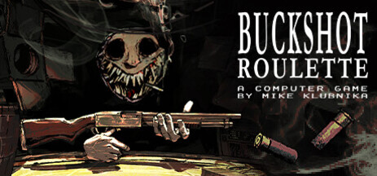
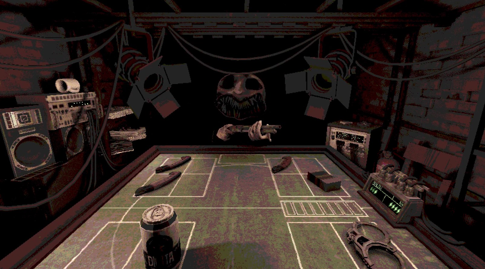
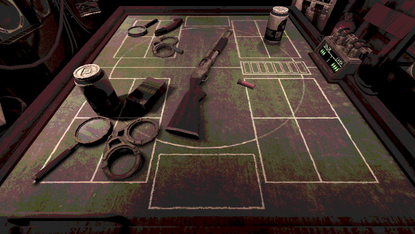
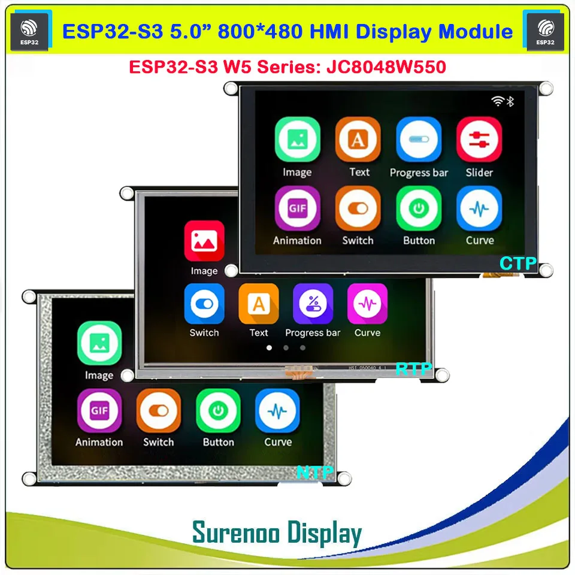
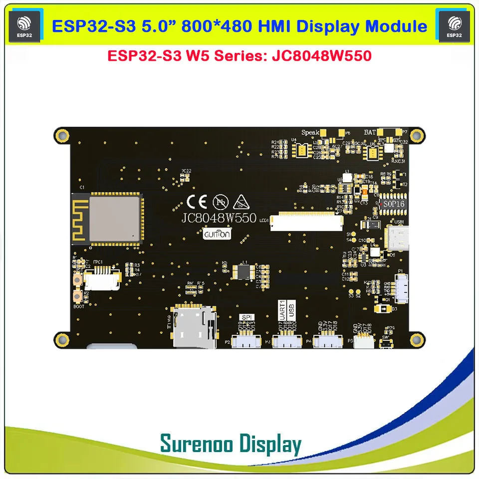

# 1. Tổng quan
## 1.1. Buckshot Roulette
Buckshot Roulette không chỉ là một trò chơi, đó là một trải nghiệm tâm lý đầy nghẹt thở, nơi ranh giới giữa vận may rủi và tư duy chiến thuật bị xóa nhòa. Được nhào nặn bởi bàn tay của nhà phát triển tài năng Mike Klubnika, trò chơi đưa bạn vào một căn phòng u tối, ngột ngạt tại một câu lạc bộ đêm dưới lòng đất, nơi bạn phải đối đầu với The Dealer — một thực thể kỳ quái và lạnh lùng — trong một ván cược sinh tử.

Điểm nhấn cốt lõi của trò chơi:
- Vòng quay Shotgun 12-Gauge: Thay vì khẩu lục quay truyền thống, trò chơi sử dụng một khẩu shotgun đầy uy lực. Cảm giác nạp từng viên đạn thật (Live) và đạn giả (Blank) vào buồng đạn tạo nên một sức nặng vật lý mà hiếm trò chơi nào làm được.
- Chiều sâu chiến thuật: Đây là điểm "ăn tiền" nhất. Trò chơi cung cấp cho bạn các vật phẩm như Kính lúp để soi đạn, Cưa tay để tăng sát thương, hay Bao thuốc để xoa dịu thần kinh (hồi máu). Việc phối hợp các vật phẩm này biến một trò chơi may rủi thành một ván cờ trí tuệ thực thụ.
- Phong cách "Gritty" độc bản: Với phong cách đồ họa góc cạnh, thô ráp (lo-fi) gợi nhớ đến thời kỳ PSX kết hợp cùng âm thanh công nghiệp (industrial music) chát chúa, game tạo ra một bầu không khí bẩn thỉu, đáng sợ nhưng không thể rời mắt.
- Cược bằng mạng sống: Bạn không chơi vì tiền, bạn chơi để tồn tại. Mỗi quyết định bóp cò là một lần tim thắt lại, tạo nên sự kịch tính đạt đến đỉnh điểm.

Trang web chính thức của trò chơi: [https://buckshotroulette.com](https://buckshotroulette.com/home)

## 1.2. Các vật phẩm & Cơ chế sinh mạng
Trong thế giới của Buckshot Roulette, may mắn chỉ là một biến số mà bạn có thể thao túng. Các vật phẩm (Items) không chỉ là công cụ hỗ trợ, chúng là những quân bài chiến lược giúp bạn lật ngược thế cờ khi họng súng đang chĩa thẳng vào đầu.

Dưới đây là mô tả về **kho khí tài gồm 9 vật phẩm chiến thuật** mà bạn sẽ sử dụng để đối đầu với cái chết:

- **Kính Lúp (Magnifying Glass):** Xuyên thấu sự thật. Cho phép bạn soi thẳng vào buồng đạn để biết chắc chắn viên đạn tiếp theo là thật hay giả. Một cái nhìn giúp xóa tan mọi nỗi sợ hãi về sự ngẫu nhiên.
- **Cưa Tay (Hand Saw):** Tàn bạo và dứt khoát. Dùng để cưa nòng khẩu shotgun, biến viên đạn thật tiếp theo thành đòn tấn công hủy diệt với sát thương gấp đôi (2 máu). Một lựa chọn "được ăn cả, ngã về không".
- **Còng Tay (Handcuffs):** Khống chế cuộc chơi. Khóa chặt đối thủ, khiến họ mất đi lượt đi tiếp theo. Trong một trò chơi mà mỗi giây đều quý giá, việc khiến đối thủ bất động là lợi thế vô giá.
- **Bao Thuốc (Cigarettes):** Xoa dịu thần kinh. Một hơi thuốc để lấy lại sự bình tĩnh giữa cơn ác mộng. Vật phẩm này giúp bạn hồi phục một đơn vị máu (Charge), kéo dài sự sống thêm một khoảnh khắc.
- **Lon Bia (Beer):** Vứt bỏ rủi ro. Bằng cách kéo nòng đẩy viên đạn hiện tại ra khỏi buồng súng mà không cần bóp cò. Một cách an toàn để loại bỏ những mối nguy hiểm không mong muốn.
- **Điện Thoại Dùng Một Lần (Burner Phone):** Nguồn tin bí ẩn. Bắt máy để được giọng nói bên kia đầu dây tiết lộ vị trí và loại đạn của một viên ngẫu nhiên còn lại trong buồng súng (ví dụ: *"Second shell is... Live!"*). Nếu chỉ còn duy nhất 1 viên trong nòng, điện thoại sẽ chỉ vang lên câu nói tiếc nuối *"How Unfortunate..."*.
- **Thuốc Hết Hạn (Expired Medicine):** Canh bạc may rủi. Uống viên thuốc để đặt cược số phận với tỉ lệ 50/50: hoặc hồi phục ngay 2 đơn vị máu, hoặc phải trả giá đắt bằng cách tự mất đi 1 đơn vị máu.
- **Bộ Đảo Cực Đạn (Inverter):** Nghịch đảo thực tại. Tác động từ tính làm biến đổi viên đạn đang nằm trong buồng súng: đạn thật chuyển thành đạn giả, và đạn giả biến thành đạn thật.
- **Thuốc Tiêm Kích Thích (Adrenaline):** Trộm cắp trong chớp mắt. Tiêm một liều thuốc kích thích để ngay lập tức cướp lấy 1 vật phẩm bất kỳ trên bàn của đối phương và sử dụng nó ngay trong lượt đó.

### **Hệ thống sinh mạng: Máy Khử Rung Tim (Defibrillator Charges)**
Không giống các vật phẩm cầm tay trong túi đồ, sinh mạng của người chơi được biểu thị bằng các nấc sốc điện (Charges) từ bộ khử rung tim với 2 cấp độ:
- **Máu Thường (Normal Charge - Level 1):** Nấc máu thông thường, có thể hồi phục lại bằng Bao thuốc lá hoặc Thuốc hết hạn.
- **Máu Sinh Tử (Faded Charge - Level 2):** Nấc máu báo động cuối cùng, không thể hồi phục bằng bất kỳ vật phẩm nào. Một khi toàn bộ máu cạn kiệt về 0, tim ngừng đập và người chơi bị xử thua ngay lập tức.

## 1.3. Buckshot Roulette Arduino
Dự án này là một phiên bản phần cứng độc lập, đưa trải nghiệm sinh tử của Buckshot Roulette lên nền tảng vi điều khiển ESP32. Không cần đến phụ kiện rườm rà, toàn bộ trò chơi được gói gọn trong một thiết bị cầm tay với giao diện tương tác trực quan qua màn hình cảm ứng, mang lại sự tiện lợi tối đa mà vẫn giữ trọn vẹn sự kịch tính của bản gốc.

### **Giao Diện Trực Quan và Tương Tác Chạm**

Trái tim của dự án là màn hình cảm ứng điện dung, nơi mọi thao tác từ chọn mục tiêu, sử dụng vật phẩm cho đến bóp cò đều được thực hiện qua những cú chạm. Giao diện được thiết kế với các phím bấm ảo có độ phản hồi hình ảnh sống động, giúp người chơi cảm nhận được sức nặng của từng quyết định.

### **Kho Vật Phẩm Kỹ Thuật Số (Virtual Items)**

Thay vì sử dụng thẻ bài vật lý, hệ thống quản lý vật phẩm được tích hợp ngay trên màn hình. Mỗi người chơi sở hữu một khay trang bị gồm 6 ô chứa đồ:
- Toàn bộ 9 vật phẩm chiến lược (*Kính lúp, Cưa tay, Lon bia, Bao thuốc, Điện thoại, Thuốc hết hạn, Còng tay, Đảo cực, Adrenaline*) hiện diện dưới dạng các ô chọn thông minh.
- Mỗi vòng người chơi được nhấn nút rút ngẫu nhiên tối đa 3 món (tối đa 6 món dự trữ).
- Chỉ với một cú chạm, hiệu ứng vật phẩm sẽ được thực thi ngay lập tức thông qua các hoạt ảnh (animation) trên màn hình và tác động trực tiếp vào các thông số trận đấu.

### **Cơ Chế Nạp Đạn & Quản Lý Máu Thông Minh**

- **Số hóa sinh mạng:** Lượng máu của hai người chơi được hiển thị bằng các biểu tượng bộ khử rung tim (Defib) sắc nét 2 tầng (Level 1 và Level 2), tự động cập nhật và phát âm thanh sau mỗi phát súng hoặc lần hồi máu.
- **Thuật toán nạp đạn:** Trước mỗi vòng, nắp hộp đạn ảo sẽ mở ra để công khai tổng số lượng đạn Thật (Live) và đạn Giả (Blank) được đưa vào súng (ngẫu nhiên từ 2 đến 8 viên, đảm bảo luôn có ít nhất 1 đạn thật). Sau đó, hộp đạn đậy nắp và thuật toán ngẫu nhiên của ESP32 sẽ xáo trộn buồng đạn, đảm bảo mỗi lần bóp cò là một khoảnh khắc đối mặt với vận may hoàn toàn công bằng và không thể đoán trước.

Đây là sự kết hợp hoàn hảo giữa tính gọn nhẹ của công nghệ nhúng và sức hấp dẫn của lối chơi chiến thuật đỉnh cao, tạo nên một thiết bị giải trí độc đáo cho những tín đồ của dòng game kinh dị tâm lý.

### **Màn hình hiển thị**

Màn hình **Guition HMI W5 (JC8048W550)** là một bo mạch hiển thị thông minh (Smart Display/HMI) tích hợp vi điều khiển mạnh mẽ **ESP32-S3**. Với cấu hình bộ nhớ lớn và tấm nền IPS sắc nét, đây là phần cứng lý tưởng cho các dự án phát triển giao diện đồ họa nhúng (GUI) sử dụng thư viện như **LVGL**, đảm bảo hiệu năng mượt mà ở độ phân giải 800x480.

### **1. Thông số cấu hình phần cứng chính**

**Bộ vi xử lý và bộ nhớ (Core & Memory)**

* **MCU:** ESP32-S3-WROOM-1 (Dual-core Xtensa LX7, xung nhịp lên đến 240MHz, tích hợp tập lệnh tăng tốc vector cho AI/đồ họa).
* **Flash:** 16 MB (N16) – Thoải mái lưu trữ firmware lớn, font chữ, và các file assets hình ảnh nhúng trực tiếp.
* **PSRAM:** 8 MB Octal PSRAM (R8) – Chạy ở chế độ Octal tốc độ cao, đóng vai trò cực kỳ quan trọng để cấp phát bộ đệm khung hình (framebuffers) lớn cho màn hình 800x480 mà không lo tràn bộ nhớ tĩnh (SRAM).
* **Kết nối không dây:** Wi-Fi 4 (802.11 b/g/n) và Bluetooth 5.0 (LE) / BLE.

**Thông số màn hình và cảm ứng (Display & Touch)**

* **Kích thước:** 5.0 inch.
* **Công nghệ tấm nền:** IPS (Góc nhìn rộng, màu sắc trung thực và độ tương phản tốt hơn nhiều so với màn TN thông thường).
* **Độ phân giải:** 800 x 480 pixels.
* **Driver hiển thị:** ST7262 (Được kết nối qua giao tiếp **16-bit RGB** trực tiếp của ESP32-S3, tối ưu hóa tối đa tốc độ làm tươi màn hình).
* **Độ sâu màu:** RGB 16-bit (65K màu - RGB565).
* **Cảm ứng:** Cảm ứng điện dung (Capacitive Touch Panel - CTP), điều khiển qua chip GT911 (Giao tiếp I2C).

### **2. Khả năng tương thích phần mềm phát triển**

Mạch được hỗ trợ rất tốt bởi cộng đồng mã nguồn mở và các framework đồ họa nhúng:

* **LVGL:** Nhờ có 8MB PSRAM kết nối qua bus Octal tốc độ cao, có thể dễ dàng cấu hình cơ chế Double Buffering (hoặc tối thiểu là 1/10 frame buffer trên PSRAM) trong LVGL để đạt tốc độ render tối đa và loại bỏ hoàn toàn hiện tượng xé hình (tearing). Tương thích tốt khi dùng kèm các thư viện driver như `Arduino_GFX` hoặc `LovyanGFX`.
* **ESPHome:** Được hỗ trợ chính thức qua các cấu hình phần cứng có sẵn, cho phép kéo trực tiếp các thực thể từ Home Assistant lên màn hình thông qua mô-đun LVGL của ESPHome mà không cần code C++ thủ công.
* **openHASP:** Hoạt động rất mượt mà (mã thiết bị: `JC8048W550`), giúp thiết kế nhanh giao diện điều khiển nhà thông minh thông qua các file cấu hình định dạng JSON.
* **Môi trường lập trình:** Hỗ trợ toàn diện ESP-IDF, Arduino IDE, và MicroPython.

### **Tìm hiểu thêm:**
[Màn hình cảm ứng Guition HMI W5 ESP32-S3-N16R8 JC8048W550 5.0 inch IPS 800*480](https://www.surenoo.com/products/23291185)

## **Tính Năng Mở Rộng: Trình Phát Nhạc Hi-Fi Từ Thẻ Nhớ**
Không chỉ dừng lại ở một máy chơi game chuyên dụng, thiết bị tận dụng tối đa khả năng giải mã âm thanh số của ESP32 qua giao tiếp I2S để trở thành một trình phát nhạc chuyên nghiệp. Thông qua khe cắm thẻ nhớ micro-SD, người chơi có thể biến thiết bị thành một máy nghe nhạc cá nhân với những đặc điểm nổi bật:

- **Quản Lý Thư Viện Nhạc Trực Quan:** Toàn bộ danh sách bài hát trong thẻ nhớ được quét tự động và hiển thị trên màn hình cảm ứng dưới dạng con lăn (Roller). Bạn có thể dễ dàng cuộn chọn bài, chuyển bài (Next/Previous), tạm dừng (Pause), theo dõi tiến trình bài hát qua vòng cung thời gian (Time Arc) hoặc điều chỉnh âm lượng chỉ với một cú chạm nhẹ.
- **Định Dạng Âm Thanh Hỗ Trợ Đa Dạng:** Nhờ thư viện giải mã âm thanh I2S tối ưu, thiết bị hỗ trợ phát **6 định dạng âm thanh phổ biến**: `.mp3`, `.wav`, `.aac`, `.m4a`, `.flac`, `.ogg`. Bạn có thể tự tạo cho mình những danh sách nhạc mang phong cách *Industrial* hay *Dark Techno* để đồng bộ với không khí u tối của trò chơi, hoặc thưởng thức những bản nhạc chất lượng cao khi thư giãn.
- **Tự Động Chuyển Bài (Auto Next):** Khi bài hát phát hết (`MSG_EOF`), hệ thống tự động nhận diện và chuyển sang phát bài tiếp theo trong danh sách mà không cần thao tác thủ công.
- **Cá Nhân Hóa Trải Nghiệm:** Giao diện nghe nhạc được thiết kế tinh giản nhưng hiện đại, đồng bộ với phong cách thẩm mỹ tổng thể của thiết bị.

## 1.4. LVGL & SquareLine Studio
Giao diện người dùng của dự án được phát triển bằng **LVGL (Light and Versatile Graphics Library) phiên bản 9.1**, kết hợp cùng công cụ thiết kế giao diện trực quan **SquareLine Studio (v1.5.3)**.

Điểm mạnh cốt lõi của giải pháp này:
- **Light (Nhẹ nhàng & Tối ưu):** LVGL được tối ưu hóa sâu cho ESP32-S3 với bộ đệm vẽ DMA kết hợp tận dụng 8MB Octal PSRAM tốc độ cao, giúp loại bỏ hoàn toàn hiện tượng giật xé hình (tearing) ngay cả ở độ phân giải lớn 800x480.
- **Versatile (Linh hoạt & Đa nền tảng):** Hỗ trợ đầy đủ widget hiện đại (Arc, Roller, Slider, Image Button, Modal Container...), hệ thống animation mượt mà và hoàn toàn độc lập với phần cứng nền tảng bên dưới.
- **Phát triển trực quan:** SquareLine Studio cho phép thiết kế layout, quản lý assets hình ảnh/font chữ, cấu hình styling và xuất ra mã nguồn C chuẩn mực (`ESP32/src/ui/`), giúp tăng tốc tối đa quá trình phát triển và kiểm thử GUI.

# 2. Phần mềm & Kiến trúc hệ thống
Dự án được xây dựng dựa trên kiến trúc phân lớp hướng sự kiện và máy trạng thái hữu hạn (**FSM**), được thiết kế để tách biệt rõ ràng trách nhiệm giữa hiển thị giao diện, quản lý dữ liệu, quy tắc logic trò chơi và tầng giao tiếp phần cứng. Kiến trúc bao gồm 5 thành phần chính: **GUI, DATA, LIB, SER,** và **SIM**.

## **1. GUI (Graphical User Interface - `ESP32/src/ui/`)**
- **Trách nhiệm:** Đảm nhiệm toàn bộ khía cạnh hiển thị đồ họa và tương tác cảm ứng người dùng.
- **Chức năng:** 
  - Bao gồm 4 màn hình chính: Màn hình khởi động (`ui_Start`), Màn hình chính chơi game (`ui_Main`), Màn hình trợ giúp (`ui_Info`), và Màn hình nghe nhạc (`ui_Music`).
  - Tích hợp các cửa sổ hộp thoại nổi (Modal Popups) trong trận đấu: Hộp thoại xác nhận bắn Shotgun (`ui_wndShotgunConfirm`), Cửa sổ soi nòng súng / nghe điện thoại (`ui_imgbtnShotgunInside`), Hộp thoại trộm đồ Adrenaline (`ui_wndAdrenalineEffect`), và Cửa sổ vinh danh kết quả (`ui_wndResult`).
- **Tương tác:** Lắng nghe các sự kiện chạm từ màn hình cảm ứng điện dung GT911 (hoặc chuột trên PC), chuyển tiếp các yêu cầu tương tác sang `ui_events.cpp` để xử lý và cập nhật lại hiển thị dựa trên trạng thái từ **DATA**/**LIB**.

## **2. DATA (Reactive Data Layer - `CommonData.*`, `CommonDataType.*`, `CData.h`)**
- **Trách nhiệm:** Định nghĩa cấu trúc dữ liệu cốt lõi và cung cấp cơ chế dữ liệu phản ứng (reactive state) dùng chung cho toàn bộ dự án.
- **Chức năng:**
  - Định nghĩa các kiểu dữ liệu và enumeration: `ITEM_TYPE` (9 vật phẩm), `BULLET_TYPE` (Live/Blank), `STATE_TYPE` (các trạng thái FSM), `PLAYER_TYPE`, `SOUND_TYPE`, `MUSIC_STATE_TYPE`.
  - Triển khai lớp mẫu `CData<T>`: Đóng gói dữ liệu kèm cờ phát hiện biến động trạng thái (`state`), cho phép các tầng lắng nghe và phản ứng tự động mỗi khi dữ liệu trận đấu (máu, lượt chơi, độ sáng, danh sách bài hát, trạng thái FSM...) thay đổi.

## **3. LIB (Game Logic Library - `CommonLibrary.*`, `FSM.h`, `Entity.h`, `Effect.h`)**
- **Trách nhiệm:** Chứa toàn bộ "trái tim" logic và quy tắc vận hành trò chơi, độc lập hoàn toàn với phần cứng và môi trường biên dịch.
- **Chức năng:**
  - **Máy trạng thái hữu hạn (FSM):** Điều phối toàn bộ chu trình ván đấu qua 10 trạng thái tuần tự: `STARTUP` (chờ 2 người chơi Ready) $\rightarrow$ `PLAYER_NEXT` $\rightarrow$ `PICK` (rút đồ) $\rightarrow$ `PLAYER_ITEM_ARRANGE` $\rightarrow$ `LOAD_SHELL` (nạp đạn) $\rightarrow$ `ACTION_TURN` (lượt bắn) $\rightarrow$ `ACTION_ITEM` (dùng vật phẩm) $\rightarrow$ `UPDATE_HP` $\rightarrow$ `SHOTGUN_SHOT` $\rightarrow$ `RESULT` (kết thúc trận).
  - **Thuật toán sinh đạn ngẫu nhiên:** Hàm `CreateBulletList()` ngẫu nhiên số lượng đạn từ 2 đến 8 viên với tỉ lệ Thật/Giả bảo đảm luôn có ít nhất 1 đạn thật, sau đó xáo trộn ngẫu nhiên vào buồng súng.
  - **Xử lý hiệu ứng vật phẩm:** File `Effect.h` hiện thực hóa chính xác chức năng của 9 vật phẩm chiến lược (soi đạn, cưa nòng x2 dame, đảo cực đạn, còng tay bỏ lượt, trộm đồ adrenaline, hồi máu, cược máu 50/50...).
  - **Quản lý thực thể (`Entity.h`):** Quản lý thông số người chơi (`player_info_t`: bàn chơi, khay đồ 6 slot, 2 tầng máu, trạng thái skip) và khẩu súng (`shotgun_info_t`: hàng đợi đạn, trạng thái cưa nòng, góc xoay).

## **4. SER (Service Layer - `CommonService.*`, `Sound.h`)**
- **Trách nhiệm:** Tầng trừu tượng hóa phần cứng (HAL) và dịch vụ hệ điều hành/hệ thống.
- **Chức năng:**
  - **Trên phần cứng ESP32 thực tế:**
    - Điều khiển âm thanh chất lượng cao qua I2S DAC bằng thư viện `ESP32-audioI2S` (kênh âm thanh đơn/đa nhiệm cho hiệu ứng game và nhạc nền).
    - Quản lý giao tiếp SPI với khe cắm thẻ nhớ micro-SD (`FS`/`SD`) để quét và nạp danh sách bài hát.
    - Điều khiển độ sáng đèn nền màn hình TFT qua tín hiệu PWM (`analogWrite`).
  - **Trên máy tính mô phỏng (PC Simulator):**
    - Sử dụng Win32 Multimedia API (`waveOutOpen`, `waveOutWrite`) để phát âm thanh mẫu PCM thô.
    - Khởi tạo cửa sổ Debug Console thời gian thực (`AllocConsole`), cho phép lập trình viên gõ các lệnh kiểm thử trực tiếp (`transit <state>`, `player <1|2>`, `setitem <id>`, `sethp <player> <level> <hp>`, `sound <id>`, `bulletbox`) mà không cần chờ phần cứng.

## **5. SIM (Windows Desktop Simulator - `Simulator/`)**
- **Trách nhiệm:** Môi trường mô phỏng đầy đủ chạy trên hệ điều hành Windows (qua Visual Studio), phục vụ việc thiết kế GUI, debug logic FSM và kiểm thử toàn bộ trò chơi trước khi triển khai lên chip ESP32.
- **Chức năng:** Tích hợp driver hiển thị và con trỏ chuột của LVGL Windows (`lv_windows_create_display`) ở đúng độ phân giải chuẩn 800x480. Biên dịch và liên kết trực tiếp các module GUI, DATA và LIB của ESP32 sang mã máy x64, giúp lập trình viên phát triển nhanh gấp nhiều lần mà không phụ thuộc vào thời gian nạp flash của vi điều khiển.

### **Lợi ích của Kiến trúc này:**
- **Phân tách trách nhiệm triệt để:** Mỗi lớp đảm nhận một nhiệm vụ riêng biệt, giữ mã nguồn gọn gàng, có tính module hóa cao và dễ dàng mở rộng.
- **Tái sử dụng mã nguồn tối đa:** Toàn bộ logic trò chơi trong LIB, mô hình dữ liệu trong DATA và giao diện trong GUI được dùng chung 100% giữa ESP32 và Windows Simulator.
- **Phát triển & Gỡ lỗi song song:** Giao diện và các quy tắc game có thể được hoàn thiện trên PC Simulator độc lập với tiến độ hàn mạch phần cứng hay nạp nạp firmware.
- **Dễ dàng kiểm thử & Đảm bảo chất lượng:** Tách biệt logic vào LIB giúp dễ dàng viết các bài kiểm thử cho từng quy tắc của trò chơi Buckshot Roulette, trong khi console debug của SIM hỗ trợ test mọi kịch bản góc hẹp (edge cases) cực kỳ tiện lợi.

# 3. Sản phẩm hoàn thiện
Chi tiết về sản phẩm đã hoàn thiện cùng hình ảnh và hướng dẫn sử dụng các màn hình, xem tại [PRODUCT.md](PRODUCT.md)
